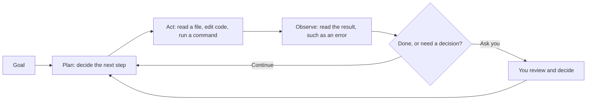

# 5. Chat Assistants vs Coding Agents

**Estimated reading time:** 5 minutes

## Chat assistant

A **chat assistant** answers questions and suggests code in a conversation. You decide what to copy, where to paste it and whether to run it.

Good for: explaining a concept, comparing options, drafting a small function, or reviewing a snippet you paste.

## Coding agent

A **coding agent** combines a model with instructions and tools so that it can work through several steps. Depending on the product, mode and permissions, it may read project files, propose a plan, edit files, or run commands and tests.

Good for: multi-step tasks in a real project, such as a feature that touches several files, as long as you review each step.

## How an agent works

An agent repeats a loop until the goal is reached or it needs your input:

Each "act" step is a tool call. Permissions decide which tools the agent may use without asking. For example, reading files may be allowed while running a terminal command asks for approval.

## Comparison

| | Chat assistant | Coding agent |
| --- | --- | --- |
| Main output | Text and code snippets | Changes in your project |
| Who applies changes | You | The agent, after your approval |
| Typical risk | Copying code you do not understand | Changing many files you did not expect |
| Your main job | Evaluate and apply | Review, run and test |

## What agents do not change

An agent does not remove your responsibility. Before you accept a change, you should:

- Review every file it changed.
- Read each command before you allow it to run.
- Compare the result with the requirements you wrote down.
- Run the app and the tests yourself.

Capabilities depend on the product, its settings and the permissions you grant. Check the current documentation for the tool you use.

## In the workshop

The demo uses **GitHub Copilot** in VS Code, including Copilot Chat and agent mode, together with **GitHub Spec Kit**. Spec Kit adds a structured workflow of specifications, plans and tasks. The thinking behind the workflow is not tied to one tool.

Next: [6. AI building blocks](/06-ai-building-blocks).
