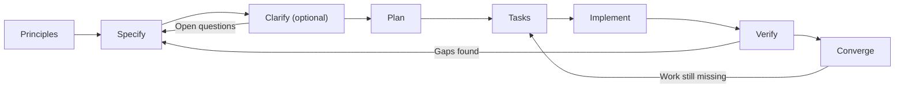

# 7. Spec-Driven Development

**Estimated reading time:** 7 minutes

A **specification (spec)** describes what to build: who needs it, what is in scope, what is out of scope and how you will know it works. A spec gives people and AI tools one reviewable document to agree on. It does not replace conversations with users or testing.

## Why write a spec before code?

Without a spec, an AI tool fills the gaps with its own assumptions. It may choose a default you did not want, add a feature nobody asked for, or change data in a way that breaks old records. A spec makes those assumptions visible while they are still cheap to change.

## The spec-driven workflow



| Step | Question it answers | Typical output |
| --- | --- | --- |
| Principles | What rules must every change follow? | Project principles (a "constitution") |
| Specify | What should the user be able to do? | Requirements and acceptance criteria |
| Clarify (optional) | What is still ambiguous? | Answers added to the spec |
| Plan | How will we build it, and what could break? | Technical plan |
| Tasks | What small steps will we take? | Ordered task list: Setup, Foundational, one phase per user story, then Polish |
| Implement | What changed in the code? | Code and tests |
| Verify | Does it meet the spec, and was it checked? | Test results and review notes |
| Converge | What do the artifacts describe that the code still lacks? | Remaining work added to `tasks.md` |

You review each artifact before moving to the next step. Problems are cheaper to fix in a document than after code has been written.

## The Spec Kit commands

The demo uses GitHub Spec Kit. It turns the workflow above into slash commands for your AI coding agent. The Spec Kit docs write commands as `/speckit.specify`. GitHub Copilot's default skills mode uses `/speckit-specify`, so use the form that Copilot Chat accepts.

| Step | Command | Role | What it does |
| --- | --- | --- | --- |
| Principles | `/speckit-constitution` | Core | Creates or updates the project principles that every later step follows. |
| Specify | `/speckit-specify` | Core | Creates requirements and user stories from your description. |
| Clarify | `/speckit-clarify` | Optional gate | Asks up to five focused questions about unclear points before planning. |
| Plan | `/speckit-plan` | Core | Writes the technical implementation plan. |
| Checklist | `/speckit-checklist` | Optional gate | Generates checklists that test the quality of the requirements. |
| Tasks | `/speckit-tasks` | Core | Breaks the plan into actionable tasks. |
| Analyze | `/speckit-analyze` | Optional gate | Compares spec, plan and tasks, then reports conflicts and gaps. It does not edit files. |
| Implement | `/speckit-implement` | Core | Carries out the tasks. |
| Converge | `/speckit-converge` | Core | After implementation, compares the code with the artifacts and adds remaining work to `tasks.md`. |

### Quality gates: checklist and analyze

- **Checklist:** a checklist for requirements. Spec Kit calls it "unit tests for your requirements". It checks whether the spec is clear and complete, not whether the code runs. You review it yourself and mark an item `[x]` only after you accept it. `/speckit-implement` reads these checkboxes and asks you before it continues if any item is still unchecked. It never ticks them for you.
- **Analyze:** a read-only check before implementation. It looks for problems such as a task with no matching requirement, or a plan choice that contradicts the spec. Fix each problem in the step that owns it, then run analyze again.

### Converge: check the result

After implementation, `/speckit-converge` compares the code with the spec, plan and tasks. It may only add remaining work to `tasks.md`; it does not edit or delete code. Converge asks "did we build everything the artifacts describe?" Tests ask "does the behavior work?" You need both.

## Anatomy of a good spec

- **User outcome:** what the user can do and why it matters.
- **Scope:** the behavior you want now.
- **Non-goals:** what you are deliberately not building.
- **Rules:** defaults, validation, and what happens to existing data.
- **Acceptance criteria:** concrete examples that can be checked.
- **Quality requirements:** for example, accessibility labels for screen readers or clear error messages.

## Worked example: task priority

Imagine a small task app where users can add tasks but cannot mark how important they are.

- **Outcome:** a user can mark a task as `High` or `Normal` when creating it, and change it later.
- **Scope:** priority is shown in the task list.
- **Rule:** tasks created before this feature have no priority and are treated as `Normal`.
- **Non-goal:** no accounts, backend, due dates or notifications.
- **Acceptance example:** given an old task without a priority, when the list opens, the task appears with `Normal` priority and can still be edited.
- **Accessibility:** the priority control has a label that a screen reader can announce.

Notice the questions the spec forces you to answer: *What is the default? What happens to old data? Is filtering included?* Those questions are much of the value.

## Write a spec in five minutes

Use this template for any small feature:

```text
User outcome:
Scope:
Non-goals:
Rules and defaults:
Acceptance example 1 (normal case):
Acceptance example 2 (edge case):
Quality requirement (for example, accessibility):
Open questions:
```

## Working in an existing project

Most real work happens in a project that already exists. Spec Kit can be added to one with `specify init --here`, which sets it up in the current folder; for example, `specify init --here --integration copilot`. Check the Spec Kit docs for the current options. For the first run, choose a **bounded first change**: one small change with a clear boundary and clear acceptance examples. Spec Kit also has optional extensions for bug fixing and for assessing an idea before you write a spec. They are not part of the core workflow.

## Spec-driven development is not tied to one stack

The workshop demo uses Expo and React Native, but the method works with any mobile stack. Your user outcome and acceptance criteria stay the same. Your technical plan, tools, build steps and tests must match your stack. For example, a Flutter or native Android project needs its own plan and its own test commands.

## Key takeaways

- Write what and why before how.
- Make acceptance examples specific enough to check.
- Name non-goals so the AI does not invent extra features.
- Review the plan and tasks before implementation starts.
- Know which quality gates are optional and what each one checks.

Next: [8. Setup checklist](/08-setup-checklist).
