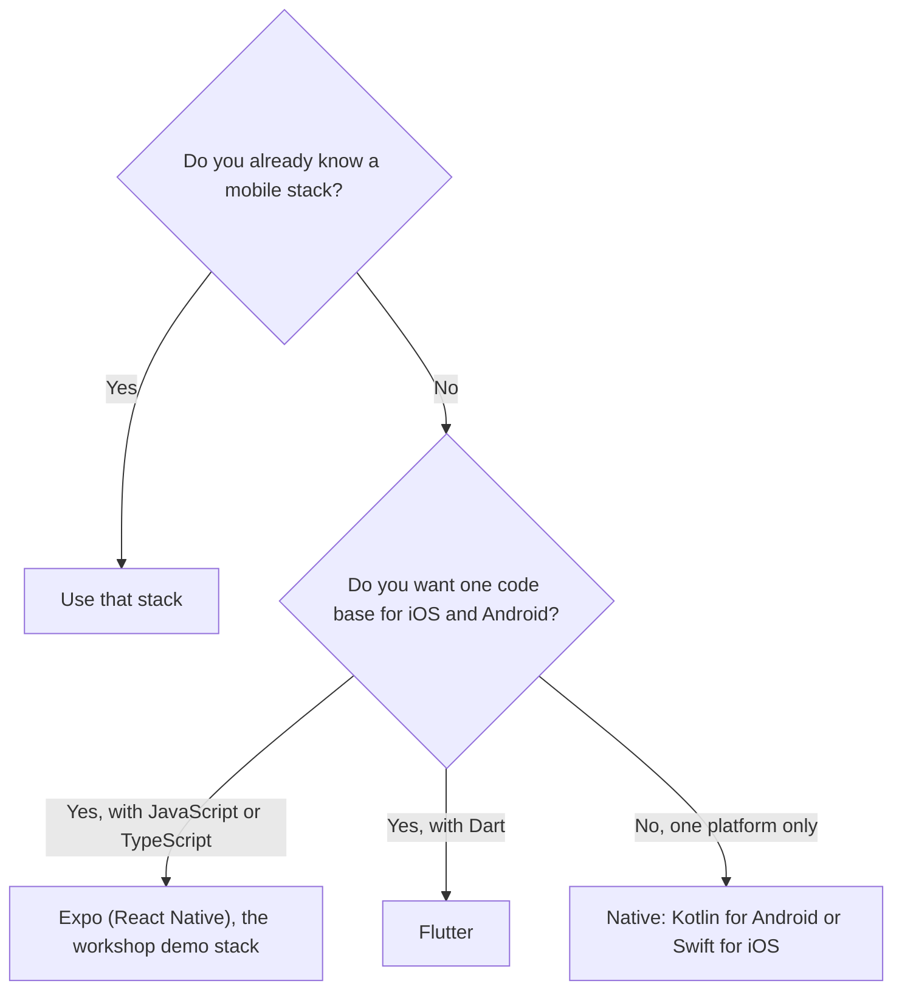

# 8. Setup Checklist

**Estimated time:** 30 to 90 minutes, depending on your machine, network and chosen stack.

Complete this checklist before the hands-on part of the workshop. The organizers may send extra instructions, such as the demo project and access details. If their instructions differ from this page, follow theirs.

## Step 1: Get an AI account

You need one of the following to take part in the hands-on demo:

| Option | Cost | Works with the workshop demo? | Notes |
| --- | --- | --- | --- |
| **GitHub Copilot** (recommended) | Student plan (free for verified students) or Pro. The Free plan also exists. | **Yes** with the Student or Pro plan. Copilot Chat and agent mode run inside VS Code. The Free plan has limited agent access and only automatic model selection, so it may not cover the whole demo. | Plans and limits change. Check the [current plans](https://github.com/features/copilot/plans) and the [plan comparison](https://docs.github.com/en/copilot/get-started/plans). The Student plan excludes third-party agents. |
| **Google AI Plus** | Paid subscription; price and availability depend on your country | **No,** not for the coding workflow. The plan covers the Gemini app, chat and Google apps. Google Antigravity, Google's agent development platform, is listed for AI Pro and AI Ultra, not AI Plus. | Check [Google's subscription page](https://gemini.google/subscriptions) for your country. You can still use Gemini chat to learn concepts. |
| **Google AI Studio** (Gemini API) | Free tier with limited access; some models are free of charge. Paid plans use pay-as-you-go rates. | **Not covered by the demo.** AI Studio is a web app and API that uses an API key. It does not provide the Copilot agent mode used in VS Code. Using Gemini inside VS Code needs a third-party tool that this guide does not cover. | Google may use free-tier content to improve its products, so never paste private code or secrets. Check the [AI Studio pricing page](https://aistudio.google.com/docs/pricing) for current models and limits. |

**What this means in practice:** the live demo uses GitHub Copilot in VS Code, with agent mode. Choose the Student or Pro plan if you want to follow every hands-on step. Google AI Plus does not include a coding agent for your project. Google AI Studio's free tier gives you Gemini models for experiments in the browser, but the demo steps do not use it. With either Google option, you can follow the concepts and ask questions in chat, but you will not be able to repeat the hands-on steps. Ask the organizers which option they expect you to use.

Students who verify their status with GitHub can apply for the Copilot Student plan. Plan details can change, so read the current terms before you sign up.

## Step 2: Install the required software

These tools are needed for everyone.

| Software | What it is for | Required? |
| --- | --- | --- |
| **Git** | Tracks changes to your project, lets you compare versions and undo mistakes. Keep a clean copy before an AI tool edits files. | **Required** |
| **Visual Studio Code** | The editor where you write code, open the project, use Copilot Chat and run the terminal. | **Required** |
| **GitHub Copilot and Copilot Chat extensions** | Adds the AI assistant and agent mode to VS Code. The workshop slash commands run here. | **Required** (for the hands-on demo) |
| **A modern web browser** (Chrome or Edge) | Lets you preview a web version of your app quickly. | **Recommended** |

Check the installation in a terminal:

```powershell
git --version
code --version
```

Then open VS Code, open Copilot Chat and send a simple message such as *"Explain what an array is in one sentence."*

## Step 3: Choose your mobile tech stack

You are free to choose the stack for your mobile app. The workshop demo uses one option, but you do not have to use it. Pick the stack you already know, or the one your team uses.

| Stack | Language | What it is for | Extra tools you need |
| --- | --- | --- | --- |
| **Expo (React Native)** (used in the demo) | JavaScript or TypeScript | Builds iOS and Android apps from one code base; the web preview runs in a browser | **Node.js LTS** to run `npm`, and optionally **Expo Go** on a phone |
| **Flutter** | Dart | Builds iOS, Android and other apps from one code base | Flutter SDK, the Flutter and Dart extensions for VS Code, and Android Studio or Xcode for emulators |
| **Native Android** | Kotlin | Builds apps only for Android with full platform access | Android Studio |
| **Native iOS** | Swift | Builds apps only for Apple devices with full platform access | Xcode (macOS only) |
| **Other stacks** (for example Kotlin Multiplatform or .NET MAUI) | Depends | Depends on the framework | Follow that framework's setup guide |



Important notes:

- **Node.js** is only needed if your stack uses JavaScript or TypeScript tooling. Do not install it just for the workshop if you choose Flutter or native development.
- **Emulators and simulators** can be heavy. A real phone with the appropriate app is often enough. Browser preview is the main route for the Expo demo.
- Your technical plan, build commands and tests will differ from the demo. The spec and acceptance criteria can still be the same.

## Step 4: Install tools for your chosen stack

Install only what your stack needs. Examples:

| If you chose | Install | What it is for |
| --- | --- | --- |
| Expo | **Node.js LTS** (check with `node -v` and `npm -v`) | Runs `npm`, installs dependencies, starts the Expo development server |
| Expo on a phone (optional) | **Expo Go** app on your phone | Opens the app on a real device |
| Flutter | Flutter SDK, Flutter and Dart extensions | Builds and runs the Flutter app |
| Any stack using the Spec Kit CLI | **Python 3.11 or newer** and **uv** ([install guide](https://docs.astral.sh/uv/getting-started/installation/)) | Installs the `specify` command, which creates the Spec Kit files in a new project |

Python and uv are needed for the Spec Kit command-line tool, even if your app is not written in Python. Expo alone does not need Python.

## Step 5: Confirm everything works

Run these checks in a terminal. Only run the ones that match your stack.

```powershell
git --version
code --version
node -v        # Expo only
npm -v         # Expo only
python --version   # Spec Kit only
uv --version       # Spec Kit only
```

In VS Code, confirm that:

- Copilot Chat answers a simple question.
- The project folder opens and the terminal starts in that folder.

## Before the session

- [ ] Choose an AI account (GitHub Copilot, Google AI Plus or Google AI Studio) and confirm you can sign in.
- [ ] Install Git and VS Code, and sign in to GitHub Copilot.
- [ ] Install the tools for your chosen stack.
- [ ] Read sections 1 to 7 of this guide (section 6 is optional).
- [ ] Complete the [self-check](/09-self-check-and-exercise).
- [ ] Ask the organizers for the demo project, or confirm you know how to get it.
- [ ] Make a backup, or use Git, before you experiment with any project.
- [ ] Close unrelated apps and notifications so the demo is easier to follow.

## Troubleshooting

- **A command is not found (for example `node` or `uv`):** restart the terminal, then VS Code. If it still fails, check that the tool is on your PATH.
- **Copilot does not respond:** confirm that you are signed in and that your plan is active. Check your organization's policy if you use a work account.
- **Slash commands do not appear:** open the project folder itself in VS Code, then reload the window.
- **Network or firewall blocks installation:** tell the organizers before the session. Do not assume that live AI generation will work offline.

## Security reminder

Never store or paste API keys, passwords, tokens or personal data into an AI prompt, a project file or a screenshot. If you expose a secret by mistake, revoke it and create a new one.
