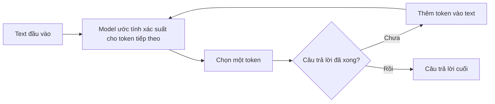
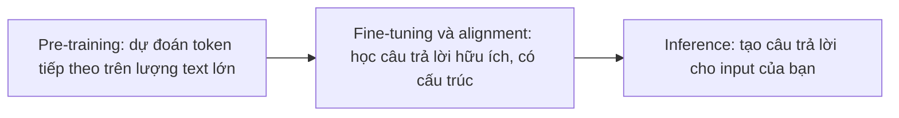

# 2. LLM hoạt động thế nào

**Thời gian đọc dự kiến:** 8 phút

Trang này giải thích điều xảy ra khi chat assistant trả lời bạn.

## Ý tưởng cốt lõi: dự đoán token tiếp theo

LLM làm một việc cơ bản: nhận text và dự đoán phần tiếp theo.

```text
Input:  "The capital of France is"
Output: "Paris"   (phần tiếp nối có khả năng cao nhất)
```

Để viết câu trả lời, model dự đoán từng mảnh, thêm vào text rồi dự đoán tiếp.

| Candidate next token | Xác suất ước tính |
| --- | --- |
| code | 30% |
| read | 20% |
| think | 10% |
| (nhiều lựa chọn khác) | 40% |

Model chọn trong các phần tiếp nối có khả năng, nên cùng câu hỏi có thể cho wording khác nhau.



## Tokens: đơn vị model đọc

Model đọc **tokens**, các mảnh text. Một token có thể là từ, phần của từ, dấu câu hoặc khoảng trắng.

- Từ phổ biến thường là một token.
- Từ dài có thể tách thành nhiều token.
- Code, số và text không phải tiếng Anh tách khác nhau.

Một token không luôn bằng một từ. Token ảnh hưởng cost và limits vì tool thường đếm token.

## Model học thế nào: training

1. **Pre-training.** Model đọc lượng text lớn, dự đoán token tiếp theo và điều chỉnh parameters. Nó học grammar, facts, style và code patterns.
2. **Fine-tuning và alignment.** Training thêm bằng câu trả lời hữu ích và human feedback để model làm theo instruction.
3. **Inference.** Model nhận input và tạo output. Parameters không đổi vì tin nhắn thông thường; hãy kiểm tra privacy settings của product.



## Vì sao LLM viết được code

Source code có patterns chặt chẽ và training data có nhiều code. Vì vậy model có thể tạo function, giải thích lỗi hoặc dịch code. Nhưng code chỉ *trông* đúng; nếu tool không chạy, model không biết nó hoạt động.

## Giới hạn cần biết

### Knowledge cutoff

Training kết thúc ở một ngày. Model có thể không biết library, API hoặc product mới. Web search giúp nhưng vẫn phải kiểm tra nguồn.

### Không tự động truy cập file

Model chỉ thấy text được gửi. Không cung cấp file thì model không biết nội dung file.

### Hallucinations

**Hallucination** là output sai hoặc không có căn cứ nhưng được trình bày tự tin, như function name, library hoặc citation bịa.

### Không phải database

Database trả đúng dữ liệu đã lưu; LLM tạo text từ patterns. Hãy xem nó là writer và reasoner cần verification, không phải encyclopedia luôn đúng.

## Mental model hữu ích

Hãy hình dung LLM là autocomplete đọc cực nhiều. Nó tiếp tục câu theo nhiều cách; độ tin cậy phụ thuộc patterns đã học và context nhận được.

- Tác vụ tốt: giải thích, soạn text, gợi ý, tìm bug pattern.
- Tác vụ rủi ro nếu không kiểm tra: API chính xác, security, pháp lý/y tế và số liệu công bố.

## Những điểm chính

- LLM lặp lại việc dự đoán token tiếp theo để xây câu trả lời.
- Training học patterns từ text lớn; inference áp dụng chúng vào input.
- Hallucination, knowledge cutoff và thiếu quyền đọc file là giới hạn bình thường.

Tiếp theo: [3. Prompt, token và context](/vi/03-prompts-tokens-context).
