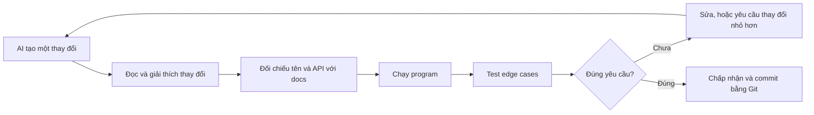

# 4. Kiểm chứng output của AI

**Thời gian đọc dự kiến:** 5 phút

AI có thể trả lời tự tin nhưng sai: bịa library, dùng API không tồn tại hoặc bỏ edge case. Việc của bạn là kiểm tra.

## Checklist khi AI viết code

1. **Đọc và giải thích change.** Không hiểu dòng nào thì hỏi assistant giải thích hoặc đơn giản hóa.
2. **Đối chiếu tên và API với docs chính thức.** Library đổi theo version.
3. **Chạy program.** Thử normal path trước.
4. **Test edge cases.** Input rỗng/dài, thiếu data, duplicate và failure.
5. **Bảo vệ data nhạy cảm.** Không dán password, API key, token, personal data hoặc private source code nếu chưa được phép.

## Vòng lặp kiểm chứng

## Tests là bằng chứng, không phải proof

Test pass chỉ cho thấy behavior đã test pass, không chứng minh toàn program đúng. Nêu rõ điều chưa test.

## Ví dụ

Sinh viên yêu cầu AI xóa completed tasks khỏi list.

- **Normal:** xóa hai completed tasks và giữ hai active tasks.
- **Edge:** không có completed tasks; không xóa và app không crash.
- **Edge:** mọi task completed; list rỗng và app hiển thị empty state.

Code chỉ xử lý normal case thì chưa xong.

## Hỏi AI tự phản biện

- “Bạn đã assumption gì?”
- “Implementation có bỏ sót requirement nào?”
- “Test nào dễ fail nhất?”

Các câu hỏi này không thay review của bạn nhưng giúp thấy gap nhanh.

## Dấu hiệu cảnh báo

- Function, option hoặc package không có trong docs.
- Code xóa/ghi đè/gửi data ngoài yêu cầu.
- Giải thích chắc chắn nhưng không có evidence.
- Assistant nói “should work” nhưng không chạy gì.

Tiếp theo: [5. Chat assistant và coding agent](/vi/05-assistants-vs-agents).
