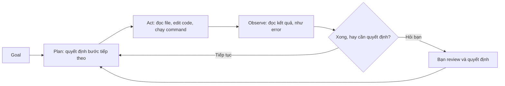

# 5. Chat assistant và coding agent

**Thời gian đọc dự kiến:** 5 phút

## Chat assistant

**Chat assistant** trả lời câu hỏi và gợi ý code trong conversation. Bạn quyết định copy, dán và chạy gì. Phù hợp để giải thích concept, so sánh lựa chọn, viết hàm nhỏ hoặc review snippet.

## Coding agent

**Coding agent** kết hợp model, instructions và tools để làm nhiều bước. Tùy product, mode và permissions, nó có thể đọc project files, lập plan, edit files hoặc chạy commands/tests.

## Agent hoạt động thế nào

Mỗi “act” là tool call. Permissions quyết định agent được làm gì không cần hỏi.

## So sánh

| | Chat assistant | Coding agent |
| --- | --- | --- |
| Output chính | Text và code snippets | Thay đổi trong project |
| Ai áp dụng change | Bạn | Agent sau approval |
| Rủi ro | Copy code không hiểu | Đổi nhiều file ngoài ý muốn |
| Việc chính | Đánh giá và áp dụng | Review, chạy và test |

## Agent không thay trách nhiệm của bạn

- Review mọi file đã đổi.
- Đọc command trước khi cho chạy.
- So sánh với requirements.
- Tự chạy app và tests.

Khả năng phụ thuộc product, settings và permissions.

## Trong workshop

Demo dùng **GitHub Copilot** trong VS Code, gồm Copilot Chat và agent mode, cùng **GitHub Spec Kit**. Spec Kit bổ sung workflow có specifications, plans và tasks.

Tiếp theo: [6. Các khối xây dựng AI](/vi/06-ai-building-blocks).
