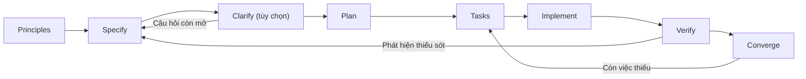

# 7. Spec-Driven Development (Phát triển dựa trên spec)

**Thời gian đọc dự kiến:** 7 phút

**Specification (spec)** mô tả cần xây gì, ai cần, scope, non-scope và cách biết nó hoạt động. Spec giúp người và AI tool thống nhất trên một tài liệu review được; không thay conversation với user hay testing.

## Vì sao viết spec trước code?

Không có spec, AI tự lấp gap bằng assumptions: chọn default sai, thêm feature không ai yêu cầu hoặc làm hỏng data cũ. Spec làm assumptions rõ khi còn rẻ để đổi.

## Workflow dựa trên spec



| Bước | Câu hỏi | Output |
| --- | --- | --- |
| Principles | Luật nào mọi change phải theo? | Project principles (constitution) |
| Specify | User cần làm gì? | Requirements và acceptance criteria |
| Clarify (tùy chọn) | Điều gì mơ hồ? | Câu trả lời trong spec |
| Plan | Build thế nào, có thể hỏng đâu? | Technical plan |
| Tasks | Các bước nhỏ là gì? | Task list có thứ tự: Setup, Foundational, một phase cho mỗi user story, rồi Polish |
| Implement | Code đổi gì? | Code và tests |
| Verify | Đạt spec và đã check chưa? | Test results và review notes |
| Converge | Code còn thiếu gì so với artifacts? | Việc còn lại được thêm vào `tasks.md` |

Review từng artifact trước bước kế. Sửa trong document rẻ hơn sau khi code xong.

## Lệnh Spec Kit

Demo dùng GitHub Spec Kit, biến workflow trên thành slash commands cho coding agent. Tài liệu Spec Kit viết lệnh dạng `/speckit.specify`. Chế độ skills mặc định của GitHub Copilot dùng `/speckit-specify`, nên dùng dạng mà Copilot Chat nhận.

| Bước | Lệnh | Vai trò | Việc làm |
| --- | --- | --- | --- |
| Principles | `/speckit-constitution` | Cốt lõi | Tạo hoặc cập nhật các nguyên tắc dự án mà mọi bước sau đều phải theo. |
| Specify | `/speckit-specify` | Cốt lõi | Tạo requirements và user stories từ mô tả của bạn. |
| Clarify | `/speckit-clarify` | Quality gate (tùy chọn) | Hỏi tối đa năm câu hỏi tập trung về điểm chưa rõ trước khi lập plan. |
| Plan | `/speckit-plan` | Cốt lõi | Viết technical implementation plan. |
| Checklist | `/speckit-checklist` | Quality gate (tùy chọn) | Tạo checklist kiểm tra chất lượng của requirements. |
| Tasks | `/speckit-tasks` | Cốt lõi | Chia plan thành các task có thể thực hiện. |
| Analyze | `/speckit-analyze` | Quality gate (tùy chọn) | So sánh spec, plan và tasks, rồi báo mâu thuẫn và thiếu sót. Không sửa file. |
| Implement | `/speckit-implement` | Cốt lõi | Thực hiện các task. |
| Converge | `/speckit-converge` | Cốt lõi | Sau khi implement, so sánh code với artifacts và thêm việc còn thiếu vào `tasks.md`. |

### Quality gates: checklist và analyze

- **Checklist:** checklist cho requirements. Spec Kit gọi nó là "unit tests cho requirements". Nó kiểm tra spec có rõ và đủ chưa, không kiểm tra code chạy hay không. Bạn tự review và chỉ đánh dấu `[x]` khi đã chấp nhận. `/speckit-implement` đọc các checkbox này và hỏi bạn trước khi tiếp tục nếu còn mục chưa tick. Nó không tự tick thay bạn.
- **Analyze:** kiểm tra chỉ đọc trước khi implement. Tìm vấn đề như task không khớp requirement nào, hoặc lựa chọn plan mâu thuẫn với spec. Sửa từng vấn đề ở bước sở hữu nó, rồi chạy analyze lại.

### Converge: kiểm tra kết quả

Sau implement, `/speckit-converge` so sánh code với spec, plan và tasks. Nó chỉ được thêm việc còn thiếu vào `tasks.md`; không sửa hay xóa code. Converge trả lời "đã build đủ những gì artifacts mô tả chưa?". Tests trả lời "behavior có chạy đúng không?". Bạn cần cả hai.

## Cấu tạo spec tốt

- **User outcome:** user làm được gì và vì sao.
- **Scope:** behavior muốn làm ngay.
- **Non-goals:** cố ý không xây.
- **Rules:** defaults, validation và xử lý data cũ.
- **Acceptance criteria:** ví dụ cụ thể để check.
- **Quality requirements:** accessibility labels, error messages rõ.

## Ví dụ: task priority

- **Outcome:** user đánh dấu task `High` hoặc `Normal` khi tạo và đổi sau.
- **Scope:** priority hiện trong list.
- **Rule:** task cũ không priority được xem là `Normal`.
- **Non-goal:** không account, backend, due dates hay notifications.
- **Acceptance:** task cũ mở lên hiện `Normal` và vẫn edit được.
- **Accessibility:** control có label cho screen reader.

Spec buộc hỏi: *Default là gì? Data cũ ra sao? Có filtering không?*

## Viết spec trong năm phút

```text
User outcome:
Scope:
Non-goals:
Rules and defaults:
Acceptance example 1 (normal case):
Acceptance example 2 (edge case):
Quality requirement (for example, accessibility):
Open questions:
```

## Làm việc trong project đã có sẵn

Phần lớn công việc thực tế diễn ra trên project đã tồn tại. Có thể thêm Spec Kit vào project bằng `specify init --here`, cài trong thư mục hiện tại; ví dụ `specify init --here --integration copilot`. Xem tài liệu Spec Kit để biết tùy chọn hiện tại. Với lần chạy đầu, chọn một **bounded first change**: một thay đổi nhỏ, có ranh giới rõ và ví dụ nghiệm thu cụ thể. Spec Kit cũng có extension tùy chọn cho việc sửa bug và đánh giá ý tưởng trước khi viết spec. Chúng không thuộc workflow cốt lõi.

## Không gắn với một stack

Demo dùng Expo và React Native nhưng phương pháp hợp mọi mobile stack. Outcome và acceptance criteria giữ nguyên; plan, tools, build steps và tests phải theo stack. Flutter hoặc native Android cần plan và test commands riêng.

## Những điểm chính

- Viết what và why trước how.
- Acceptance examples phải đủ cụ thể để check.
- Nêu non-goals để AI không bịa feature.
- Review plan và tasks trước implementation.
- Biết quality gate nào là tùy chọn và mỗi gate kiểm tra gì.

Tiếp theo: [8. Checklist chuẩn bị](/vi/08-setup-checklist).
