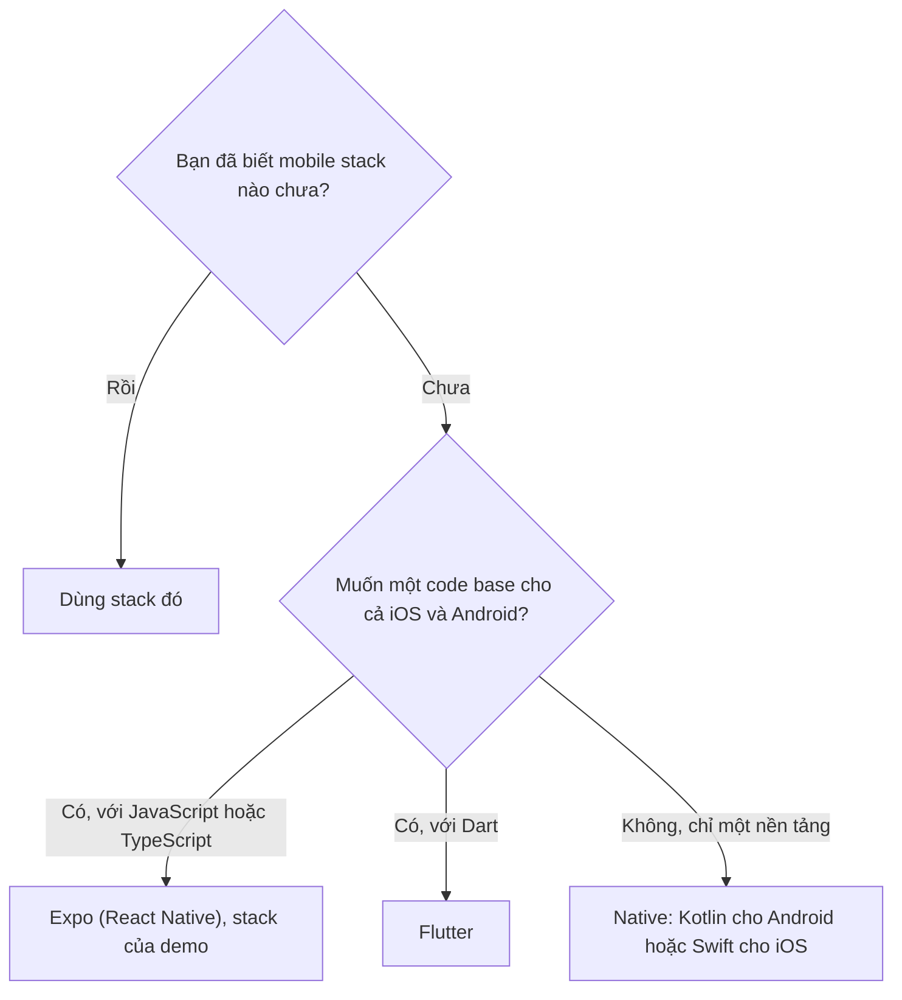

# 8. Danh sách chuẩn bị

**Thời gian ước tính:** 30 đến 90 phút, tùy máy tính, mạng và tech stack bạn chọn.

Hoàn thành danh sách này trước phần thực hành của workshop. Ban tổ chức có thể gửi thêm hướng dẫn, chẳng hạn như project demo và thông tin truy cập. Nếu hướng dẫn của họ khác với trang này, hãy làm theo hướng dẫn của họ.

## Bước 1: Có tài khoản AI

Bạn cần một trong các lựa chọn sau để tham gia phần demo thực hành:

| Lựa chọn | Chi phí | Dùng được với demo của workshop? | Ghi chú |
| --- | --- | --- | --- |
| **GitHub Copilot** (khuyến nghị) | Gói Student (miễn phí cho sinh viên đã xác minh) hoặc Pro. Cũng có gói Free. | **Có** với gói Student hoặc Pro. Copilot Chat và agent mode chạy trong VS Code. Gói Free có quyền agent hạn chế và chỉ tự chọn model, nên có thể không đủ cho toàn bộ demo. | Gói và giới hạn có thể thay đổi. Xem [các gói hiện tại](https://github.com/features/copilot/plans) và [so sánh gói](https://docs.github.com/en/copilot/get-started/plans). Gói Student không bao gồm agent của bên thứ ba. |
| **Google AI Plus** | Gói trả phí; giá và khả năng sử dụng tùy theo quốc gia | **Không** với quy trình coding. Gói này gồm ứng dụng Gemini, chat và các ứng dụng Google. Google Antigravity, nền tảng phát triển agent của Google, chỉ được liệt kê cho AI Pro và AI Ultra, không có ở AI Plus. | Xem [trang đăng ký của Google](https://gemini.google/subscriptions) cho quốc gia của bạn. Bạn vẫn có thể dùng Gemini chat để học khái niệm. |
| **Google AI Studio** (Gemini API) | Gói Free có giới hạn truy cập; một số model miễn phí. Gói trả phí tính theo mức dùng (pay-as-you-go). | **Không nằm trong demo.** AI Studio là ứng dụng web và API dùng API key. Nó không có agent mode của Copilot trong VS Code. Dùng Gemini trong VS Code cần công cụ bên thứ ba mà hướng dẫn này không đề cập. | Google có thể dùng nội dung của gói Free để cải thiện sản phẩm, nên đừng dán code riêng tư hoặc secret vào đó. Xem [trang giá của AI Studio](https://aistudio.google.com/docs/pricing) để biết model và giới hạn hiện tại. |

**Điều này có nghĩa gì trong thực tế:** demo trực tiếp dùng GitHub Copilot trong VS Code, với agent mode. Hãy chọn gói Student hoặc Pro nếu bạn muốn làm theo mọi bước thực hành. Google AI Plus không có agent coding chạy trên project của bạn. Gói Free của Google AI Studio cho bạn dùng model Gemini để thử nghiệm trên trình duyệt, nhưng các bước demo không dùng nó. Với cả hai lựa chọn Google, bạn có thể theo các khái niệm và hỏi trong chat, nhưng không làm lại được các bước thực hành. Hãy hỏi ban tổ chức xem họ mong đợi bạn dùng lựa chọn nào.

Sinh viên xác minh trạng thái với GitHub có thể đăng ký gói Copilot Student. Thông tin gói có thể thay đổi, vì vậy hãy đọc điều khoản hiện tại trước khi đăng ký.

## Bước 2: Cài đặt phần mềm bắt buộc

Các công cụ sau cần cho tất cả mọi người.

| Phần mềm | Dùng để làm gì | Bắt buộc? |
| --- | --- | --- |
| **Git** | Theo dõi thay đổi của project, so sánh các phiên bản và hoàn tác lỗi. Hãy giữ một bản sạch trước khi công cụ AI chỉnh sửa file. | **Bắt buộc** |
| **Visual Studio Code** | Trình soạn thảo nơi bạn viết code, mở project, dùng Copilot Chat và chạy terminal. | **Bắt buộc** |
| **Extension GitHub Copilot và Copilot Chat** | Thêm trợ lý AI và agent mode vào VS Code. Các slash command của workshop chạy tại đây. | **Bắt buộc** (cho demo thực hành) |
| **Trình duyệt web hiện đại** (Chrome hoặc Edge) | Cho phép xem nhanh phiên bản web của ứng dụng. | **Khuyến nghị** |

Kiểm tra cài đặt trong terminal:

```powershell
git --version
code --version
```

Sau đó mở VS Code, mở Copilot Chat và gửi một câu đơn giản như *"Explain what an array is in one sentence."* (Giải thích array là gì trong một câu.)

## Bước 3: Chọn tech stack cho ứng dụng di động

Bạn được tự do chọn tech stack cho ứng dụng di động. Demo của workshop dùng một lựa chọn, nhưng bạn không bắt buộc phải dùng nó. Hãy chọn stack mà bạn đã biết, hoặc stack mà nhóm bạn đang dùng.

| Stack | Ngôn ngữ | Dùng để làm gì | Công cụ bổ sung cần có |
| --- | --- | --- | --- |
| **Expo (React Native)** (dùng trong demo) | JavaScript hoặc TypeScript | Xây dựng ứng dụng iOS và Android từ một code base; bản xem trước web chạy trên trình duyệt | **Node.js LTS** để chạy `npm`, và tùy chọn **Expo Go** trên điện thoại |
| **Flutter** | Dart | Xây dựng ứng dụng iOS, Android và các nền tảng khác từ một code base | Flutter SDK, extension Flutter và Dart cho VS Code, cùng Android Studio hoặc Xcode để chạy emulator |
| **Android native** | Kotlin | Xây dựng ứng dụng chỉ cho Android với đầy đủ quyền truy cập nền tảng | Android Studio |
| **iOS native** | Swift | Xây dựng ứng dụng chỉ cho thiết bị Apple với đầy đủ quyền truy cập nền tảng | Xcode (chỉ macOS) |
| **Các stack khác** (ví dụ Kotlin Multiplatform hoặc .NET MAUI) | Tùy loại | Tùy framework | Làm theo hướng dẫn cài đặt của framework đó |



Lưu ý quan trọng:

- **Node.js** chỉ cần khi stack của bạn dùng công cụ JavaScript hoặc TypeScript. Đừng cài nó chỉ vì workshop nếu bạn chọn Flutter hoặc phát triển native.
- **Emulator và simulator** khá nặng. Một điện thoại thật với ứng dụng phù hợp thường là đủ. Với demo Expo, xem trước trên trình duyệt là cách chính.
- Kế hoạch kỹ thuật, lệnh build và test của bạn sẽ khác với demo. Spec và acceptance criteria vẫn có thể giữ nguyên.

## Bước 4: Cài công cụ cho tech stack đã chọn

Chỉ cài những gì stack của bạn cần. Ví dụ:

| Nếu bạn chọn | Cài đặt | Dùng để làm gì |
| --- | --- | --- |
| Expo | **Node.js LTS** (kiểm tra bằng `node -v` và `npm -v`) | Chạy `npm`, cài dependency, khởi động Expo development server |
| Expo trên điện thoại (tùy chọn) | Ứng dụng **Expo Go** trên điện thoại | Mở ứng dụng trên thiết bị thật |
| Flutter | Flutter SDK, extension Flutter và Dart | Build và chạy ứng dụng Flutter |
| Mọi stack dùng Spec Kit CLI | **Python 3.11 trở lên** và **uv** ([hướng dẫn cài đặt](https://docs.astral.sh/uv/getting-started/installation/)) | Cài lệnh `specify`, lệnh này tạo các file Spec Kit trong project mới |

Python và uv cần cho công cụ dòng lệnh Spec Kit, ngay cả khi ứng dụng của bạn không viết bằng Python. Riêng Expo không cần Python.

## Bước 5: Kiểm tra mọi thứ hoạt động

Chạy các lệnh sau trong terminal. Chỉ chạy những lệnh phù hợp với stack của bạn.

```powershell
git --version
code --version
node -v            # chỉ Expo
npm -v             # chỉ Expo
python --version   # chỉ Spec Kit
uv --version       # chỉ Spec Kit
```

Trong VS Code, hãy xác nhận rằng:

- Copilot Chat trả lời được một câu hỏi đơn giản.
- Thư mục project mở được và terminal khởi động ngay trong thư mục đó.

## Trước buổi học

- [ ] Chọn tài khoản AI (GitHub Copilot, Google AI Plus hoặc Google AI Studio) và xác nhận bạn đăng nhập được.
- [ ] Cài Git và VS Code, rồi đăng nhập GitHub Copilot.
- [ ] Cài công cụ cho tech stack bạn đã chọn.
- [ ] Đọc mục 1 đến 7 của tài liệu này (mục 6 là tùy chọn).
- [ ] Làm [bài tự kiểm tra](/vi/09-self-check-and-exercise).
- [ ] Hỏi ban tổ chức về project demo, hoặc xác nhận bạn biết cách lấy nó.
- [ ] Sao lưu hoặc dùng Git trước khi thử nghiệm bất kỳ project nào.
- [ ] Đóng các ứng dụng và thông báo không liên quan để dễ theo dõi demo hơn.

## Xử lý sự cố

- **Không tìm thấy lệnh (ví dụ `node` hoặc `uv`):** khởi động lại terminal, sau đó khởi động lại VS Code. Nếu vẫn lỗi, kiểm tra công cụ đã nằm trong PATH chưa.
- **Copilot không phản hồi:** xác nhận bạn đã đăng nhập và gói của bạn còn hiệu lực. Nếu dùng tài khoản công việc, hãy kiểm tra chính sách của tổ chức.
- **Slash command không xuất hiện:** mở đúng thư mục project trong VS Code, rồi tải lại cửa sổ.
- **Mạng hoặc tường lửa chặn việc cài đặt:** báo cho ban tổ chức trước buổi học. Đừng giả định rằng việc sinh nội dung AI trực tiếp sẽ hoạt động khi offline.

## Lưu ý về bảo mật

Không lưu hoặc dán API key, mật khẩu, token hay dữ liệu cá nhân vào prompt AI, file project hay ảnh chụp màn hình. Nếu lỡ lộ một bí mật, hãy thu hồi nó và tạo mới.
